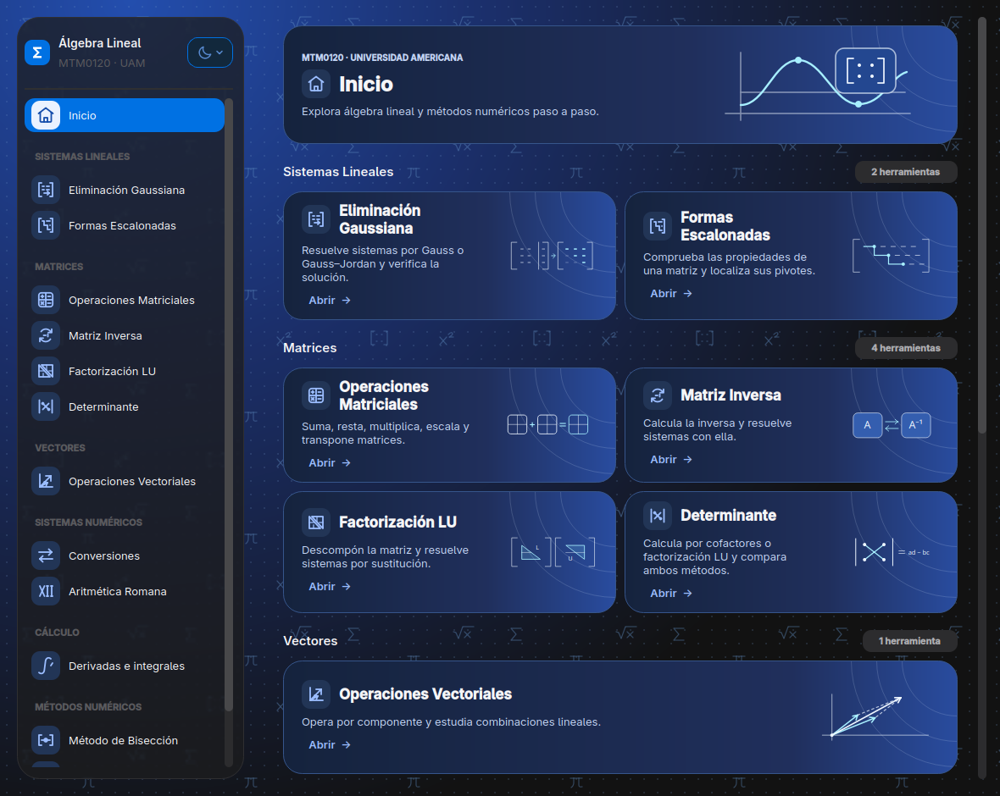
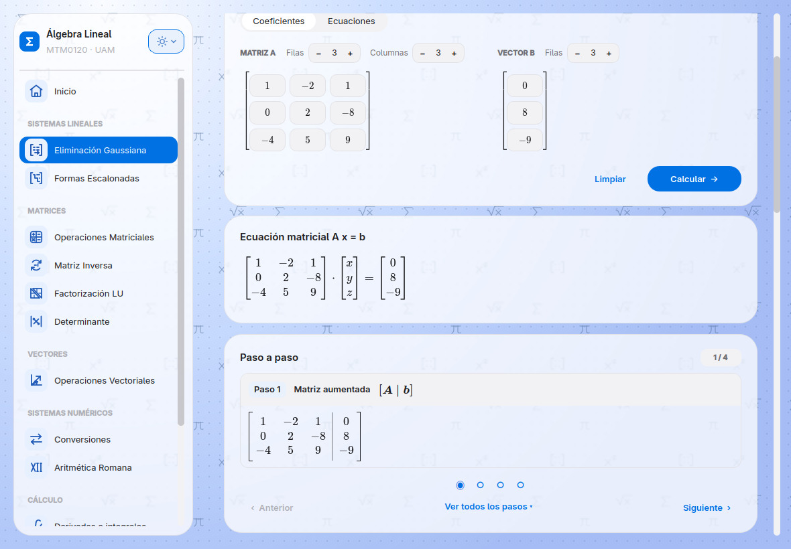
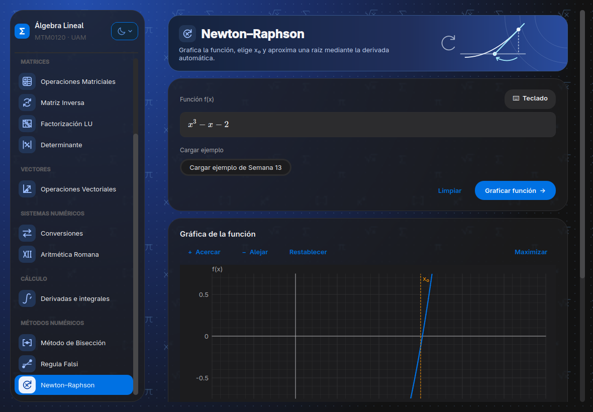

<p align="center">
  
</p>

<h1 align="center">linalg-calculator</h1>

<p align="center">
  <strong>Álgebra lineal y métodos numéricos, paso a paso.</strong><br>
  Resuelve sistemas con fracciones exactas y explora raíces con gráficas interactivas.
</p>

<p align="center">
  <a href="#inicio-rápido"></a>
  <a href="requirements.txt"></a>
  <a href="docs/gui.md#editor-de-funciones"></a>
  <a href="LICENSE"></a>
  <a href="https://github.com/BismarckFlores/linalg-calculator/commits/main/"></a>
</p>

<p align="center">
  <a href="#inicio-rápido"><strong>🚀 Probar la app</strong></a> ·
  <a href="#características">Características</a> ·
  <a href="docs/README.md">Documentación</a>
</p>

---

<p align="center">
  <a href="docs/images/inicio-catalogo-oscuro.png"></a>
</p>

<table>
  <tr>
    <th>Eliminación gaussiana · Tema claro</th>
    <th>Newton–Raphson · Tema oscuro</th>
  </tr>
  <tr>
    <td><a href="docs/images/gauss-paso-a-paso.png"></a></td>
    <td><a href="docs/images/newton-raphson.png"></a></td>
  </tr>
</table>

## Características

- **Sistemas lineales.** Ingresa coeficientes o ecuaciones, aplica Gauss o Gauss–Jordan y revisa las operaciones por filas, los pivotes y la clasificación de la solución.
- **Matrices y vectores.** Calcula inversas, factorizaciones LU, determinantes y combinaciones lineales. Las operaciones de álgebra lineal conservan las fracciones exactas.
- **Búsqueda de raíces.** Usa Bisección, Regula Falsi o Newton–Raphson, explora la gráfica y revisa la tabla de iteraciones.
- **Cálculo.** Obtén derivadas, antiderivadas e integrales definidas con resultados simbólicos.
- **Conversiones.** Convierte entre decimal, bases de 2 a 36 y números romanos. La aritmética romana incluye suma, resta y multiplicación.
- **Escritorio en español.** Trece herramientas con temas claro, oscuro y automático. El editor y sus fuentes se cargan localmente, por lo que puedes usar la app sin conexión después de instalarla.

## Inicio rápido

Necesitas **Python 3.12 o posterior** y una sesión gráfica.

```bash
git clone https://github.com/BismarckFlores/linalg-calculator.git
cd linalg-calculator
```

**Linux y macOS**

```bash
python3 -m venv .venv
.venv/bin/python -m pip install -r requirements.txt
.venv/bin/python main.py
```

**Windows · PowerShell**

```powershell
py -3 -m venv .venv
.\.venv\Scripts\python.exe -m pip install -r requirements.txt
.\.venv\Scripts\python.exe main.py
```

Para probarla, abre **Eliminación Gaussiana**, pulsa **Calcular** con el ejemplo
precargado y usa **Siguiente** para recorrer las operaciones.

## Cómo funciona

La interfaz oficial usa **PySide6** y ejecuta el editor **MathLive** en
**Qt WebEngine**. El motor de **Python** valida las entradas, calcula con
`Fraction` en álgebra lineal y usa punto flotante para aproximar raíces.
El registro de operaciones e iteraciones alimenta el paso a paso y las tablas.
MathLive presenta las matrices, las ecuaciones y las operaciones en LaTeX.
La versión **CustomTkinter** se conserva como referencia histórica en la
[guía de la interfaz heredada](docs/legacy-gui.md).

## 📚 Documentación

- [Índice de documentación](docs/README.md) · Guías, ejercicios y referencia.
- [Guía de uso](docs/usage.md) · Primeros ejercicios e instalación.
- [Un sistema resuelto de principio a fin](docs/how-it-works.md) · Eliminación, despeje y comprobación.
- [Newton–Raphson](docs/gui.md#newtonraphson) · Selección de la aproximación inicial en la gráfica.
- [Bisección y Regula Falsi](docs/bisection.md) · Criterios de parada y ejemplos.
- [Diseño y arquitectura](docs/design.md) · Motor, interfaz y registro de operaciones.

El código del proyecto está bajo la [licencia MIT](LICENSE).
Los recursos incluidos conservan sus avisos de [MathLive](desktop/assets/vendor/LICENSE.txt)
y [KaTeX](desktop/assets/vendor/LICENSE-KaTeX.txt).
